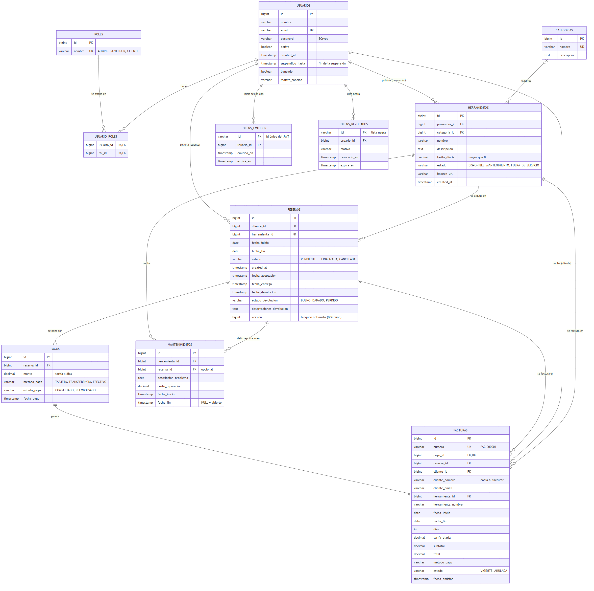

# 🛠️ Plataforma de Renta de Herramientas y Equipos de Construcción

Aplicación web para alquilar herramientas y equipos de construcción. Los **proveedores** publican su inventario, los
**clientes** reservan por fechas, pagan en línea y descargan su factura, y el **administrador** supervisa usuarios, pagos,
devoluciones con daños y la rentabilidad de la plataforma.

- **Backend:** API REST con **Spring Boot 4.1** (última versión) y Java 21, seguridad con JWT y arquitectura hexagonal en tres módulos Maven.
- **Base de datos:** MySQL 8 con migraciones Flyway, scripts SQL y datos de demostración (20 o más registros por entidad).
- **Frontend:** HTML, CSS y JavaScript puro con Bootstrap 5, responsivo, con un panel distinto para cada rol.
- **Despliegue:** WAR en **Apache Tomcat 11** (con Docker Compose o en un Tomcat instalado).
- **Documentación y pruebas:** Swagger con ejemplos JSON, colección de Postman y 204 pruebas automatizadas.

---

## Contenido

1. [Funcionalidades](#1-funcionalidades)
2. [Tecnologías](#2-tecnologías)
3. [Arquitectura y estructura del proyecto](#3-arquitectura-y-estructura-del-proyecto)
4. [Instalación y ejecución](#4-instalación-y-ejecución)
5. [Configuración (`application.properties`)](#5-configuración-applicationproperties)
6. [Base de datos](#6-base-de-datos)
7. [Autenticación y roles](#7-autenticación-y-roles)
8. [Endpoints de la API](#8-endpoints-de-la-api)
9. [Reglas de negocio](#9-reglas-de-negocio)
10. [Frontend](#10-frontend)
11. [Pruebas](#11-pruebas)
12. [Solución de problemas](#12-solución-de-problemas)

---

## 1. Funcionalidades

| Rol | Puede |
|---|---|
| **Administrador** | Registrar, editar, desactivar y eliminar proveedores y clientes. Gestionar herramientas y categorías. Ver el historial de alquileres y el estado de los equipos. Atender incidencias (equipos dañados o perdidos). Supervisar pagos y facturación (corregir el método o reembolsar). Ver reportes de ingresos, rentabilidad, herramientas más alquiladas, clientes frecuentes y disponibilidad. El **administrador principal** (`admin@rentas.com`) es el único que puede ascender o bajar de rango a los usuarios. |
| **Proveedor** | Publicar, editar y eliminar sus herramientas con imagen, descripción, costo y estado. Aceptar o rechazar solicitudes de alquiler. Registrar entregas y confirmar devoluciones reportando daños. Gestionar mantenimientos. Consultar las facturas generadas por sus alquileres. También puede **alquilar herramientas de otros proveedores** como un cliente: reservar, pagar y descargar sus facturas (nunca sus propias herramientas). |
| **Cliente** | Registrarse e iniciar sesión. Buscar herramientas por categoría, texto y disponibilidad en un rango de fechas. Reservar, cambiar las fechas o cancelar. Pagar en línea (confirmación automática). Descargar sus facturas y revisar su historial. |

---

## 2. Tecnologías

| Área | Tecnología |
|---|---|
| Lenguaje | **Java 21** (el enunciado pide Java 17 como mínimo y Java 21 para el backend; se usa 21) |
| Backend | **Spring Boot 4.1.1** (última versión): Spring Framework 7, Spring MVC, Data JPA / Hibernate 7, Validation, Security 7, Jackson 3 |
| Seguridad | Spring Security + **JWT** (JJWT 0.12.5, HS512), contraseñas con BCrypt |
| Base de datos | **MySQL 8.4**, migraciones con **Flyway** |
| Documentación | **Swagger** / OpenAPI 3 (springdoc 3.1.1) y colección de **Postman** |
| Facturas | **PDF** generado con OpenPDF 3.0.5 |
| Frontend | HTML5, CSS3, JavaScript (módulos ES), **Bootstrap 5.3** y Bootstrap Icons |
| Despliegue | **Apache Tomcat 11** (WAR, Jakarta EE 11), Docker y Docker Compose |
| Pruebas | JUnit 5, AssertJ, Mockito, Spring Boot Test (MockMvc), **Testcontainers** (MySQL real), Newman |

---

## 3. Arquitectura y estructura del proyecto

El proyecto sigue una **arquitectura hexagonal** (puertos y adaptadores), separada en tres módulos Maven. El dominio y los
casos de uso no dependen de Spring: la infraestructura los conecta.

```
domain          → modelos de negocio, reglas de transición de estados, objetos de valor, excepciones y puertos de repositorio
application     → casos de uso (puertos de entrada), DTOs y servicios con las reglas de negocio y de acceso por rol
infraestructura → Spring Boot: controllers REST, seguridad JWT, JPA, Flyway, configuración, frontend estático (WAR)
```

```
├── domain/src/main/java/com/example/tomcat
│   ├── model/            Usuario, Herramienta, Categoria, Reserva, Pago, Factura, Mantenimiento, Rol
│   ├── valueobject/      Dinero, Email
│   ├── exception/        DomainException (400), RecursoNoEncontrado (404), Conflicto (409), AccesoDenegado (403)...
│   └── repository/       Puertos de persistencia (interfaces)
├── application/src/main/java/com/example/tomcat
│   ├── port/in/          Casos de uso (interfaces) y DTOs (Solicitante, Panel, reportes)
│   ├── port/out/         Puertos de salida (cifrado de contraseñas, almacenamiento de imágenes)
│   └── service/          Implementación de los casos de uso, ControlAcceso, PoliticaVencimiento
├── infraestructura/src/main
│   ├── java/.../adapter/in/rest/        Controllers REST (DTOs de entrada con Bean Validation) y manejo de errores
│   ├── java/.../adapter/out/            Entidades JPA, repositorios Spring Data, mappers, almacenamiento en disco
│   ├── java/.../security/               Filtro JWT, configuración de Spring Security, errores 401/403 en JSON
│   ├── java/.../config/                 Cableado de casos de uso, transacciones, CORS, Swagger, vencimiento programado
│   ├── resources/db/migration/          Migraciones Flyway V1–V14
│   └── resources/static/                Frontend (index.html, css/, js/, images/)
├── sql/                schema.sql y data.sql (creación y población de la base)
├── docs/               Diagrama relacional (imagen y fuente Mermaid)
├── postman/            Colección y entorno de Postman
├── Dockerfile, compose.yaml
└── pom.xml             Proyecto padre multimódulo
```

**Capas en una petición:** `Controller` (valida el DTO y toma el usuario del JWT) → **caso de uso** (reglas de negocio y de
propiedad, en una transacción) → **puerto de repositorio** → adaptador JPA → MySQL.

---

## 4. Instalación y ejecución

### Requisitos

- **Docker Desktop** (opción A), o bien **JDK 21** y **MySQL 8** (opciones B y C).
- Git. No hace falta instalar Maven: el proyecto trae el wrapper (`mvnw` / `mvnw.cmd`), que descarga Maven y las dependencias.

### Clonar el repositorio

```bash
git clone https://github.com/pau091/Plataforma_de_Renta_de_Herramientas.git
cd Plataforma_de_Renta_de_Herramientas
```

> En Windows, si `git clone` muestra `Filename too long`, ejecute antes `git config --global core.longpaths true`
> o clone en una carpeta con una ruta más corta (por ejemplo `C:\proyectos`).

### Preparar Docker (macOS, Linux o Windows)

Docker no necesita ninguna configuración especial para este proyecto: basta con instalarlo y tenerlo **abierto**. Las
imágenes que se usan (MySQL 8.4, Maven y Tomcat 11) funcionan en procesadores Intel/AMD y en Mac con chip Apple (M1, M2, M3...).

**macOS**
1. Descargue **Docker Desktop** desde https://www.docker.com/products/docker-desktop/ y elija la versión de su procesador:
   *Apple Silicon* (chip M1/M2/M3...) o *Intel* (menú  → Acerca de este Mac lo indica).
2. Abra el `.dmg`, arrastre Docker a *Aplicaciones* y ábralo. Acepte los permisos que pida.
3. Espere a que el ícono de la ballena en la barra superior indique *Docker Desktop is running*.
4. Compruebe en la Terminal: `docker --version` y `docker compose version`.

**Linux (Ubuntu / Debian)**
```bash
curl -fsSL https://get.docker.com | sudo sh     # instala Docker Engine y el plugin "docker compose"
sudo usermod -aG docker $USER                   # usar docker sin sudo (cierre sesión y vuelva a entrar)
docker --version && docker compose version
```
(En otras distribuciones, o si prefiere una interfaz gráfica, puede instalar Docker Desktop para Linux.)

**Windows:** instale Docker Desktop y ábralo antes de ejecutar los comandos.

### Ejecutar después de clonar (macOS / Linux)

```bash
git clone https://github.com/pau091/Plataforma_de_Renta_de_Herramientas.git
cd Plataforma_de_Renta_de_Herramientas
docker compose up -d --build        # la primera vez tarda unos minutos: descarga imágenes y compila
docker compose logs -f tomcat       # espere "Server startup in [...] milliseconds" y salga con Ctrl+C
```

Abra http://localhost:8080 e ingrese con una de las [cuentas de demostración](#cuentas-de-demostración).
Para las pruebas (opcional): `./mvnw verify` (requiere JDK 21 y Docker abierto). Si la terminal responde
`Permission denied` al ejecutar `./mvnw`, ejecute una vez `chmod +x mvnw`.

### Opción A: Docker Compose (recomendada)

Levanta MySQL 8.4 y la aplicación desplegada como `ROOT.war` en un **Apache Tomcat 11** con JDK 21. Flyway crea las tablas y
carga los datos de demostración la primera vez.

```bash
docker compose up -d --build      # construye el WAR con Maven y arranca MySQL + Tomcat
docker compose logs -f tomcat     # espere "Server startup in [...] milliseconds" y salga con Ctrl+C
```

| Qué | Dirección |
|---|---|
| Aplicación (frontend) | http://localhost:8080 |
| Swagger | http://localhost:8080/swagger-ui/index.html |
| OpenAPI (JSON) | http://localhost:8080/v3/api-docs |
| MySQL desde el equipo | `localhost:3307`, usuario `mysql`, clave `mysql`, base `renta_herramientas_db` |

```bash
docker compose down      # detener (conserva los datos)
docker compose down -v   # detener y BORRAR los datos; al volver a subir se recrean los datos de demostración
```

MySQL se publica en el puerto **3307** para no chocar con un MySQL instalado en el equipo (3306). Las imágenes subidas se
guardan en el volumen `uploads`.

### Opción B: ejecución local con Maven

1. Tenga un MySQL 8 en ejecución. Por ejemplo, solo el de Docker: `docker compose up -d mysql` (puerto 3307).
   La base `renta_herramientas_db` se crea sola gracias a `createDatabaseIfNotExist=true`.
2. Compile y ejecute (el WAR incluye un Tomcat embebido):

```bash
# Linux / macOS / Git Bash
./mvnw clean package -DskipTests
java -jar infraestructura/target/infraestructura-0.0.1-SNAPSHOT.war
```
```powershell
# Windows PowerShell
.\mvnw.cmd clean package -DskipTests
java -jar infraestructura\target\infraestructura-0.0.1-SNAPSHOT.war
```

Para usar otra base de datos, defina las variables de la [sección 5](#5-configuración-applicationproperties) antes de
ejecutar. Por ejemplo: `DB_URL=jdbc:mysql://localhost:3306/renta_herramientas_db?createDatabaseIfNotExist=true&useSSL=false&allowPublicKeyRetrieval=true&serverTimezone=UTC`.

### Opción C: despliegue en un Apache Tomcat instalado

1. Genere el WAR con `./mvnw clean package -DskipTests`.
2. Use **Apache Tomcat 11** (Jakarta EE 11, la misma versión de la imagen Docker) ejecutándose con **Java 21**.
   Spring Boot 4 no funciona en Tomcat 10.1.
3. Copie `infraestructura/target/infraestructura-0.0.1-SNAPSHOT.war` a `<TOMCAT>/webapps/ROOT.war` para que quede en la raíz `/`.
4. Configure la conexión en `<TOMCAT>/bin/setenv.bat` (Windows) o `setenv.sh` (Linux):

```bat
set "DB_URL=jdbc:mysql://localhost:3306/renta_herramientas_db?createDatabaseIfNotExist=true&useSSL=false&allowPublicKeyRetrieval=true&serverTimezone=UTC"
set "DB_USERNAME=mysql"
set "DB_PASSWORD=mysql"
set "JWT_SECRET=una-clave-secreta-larga-de-al-menos-64-caracteres-para-firmar-los-tokens-HS512"
set "APP_UPLOADS_DIR=C:\renta-herramientas\uploads"
```

5. Inicie Tomcat (`bin/startup.bat` o `bin/startup.sh`) y abra http://localhost:8080.

### Cuentas de demostración

La clave de todas es **`Rentas2026*`**.

| Rol | Cuenta | Notas |
|---|---|---|
| Administrador | `admin@rentas.com` | |
| Proveedor | `carlos.proveedor@gmail.com` | Dueño de las herramientas 1 y 2 (hay 20 proveedores) |
| Cliente | `juan.cliente@gmail.com` | El cliente más frecuente (hay 20 clientes) |
| Cliente inactivo | `gabriel.mantenimiento@gmail.com` | Cuenta desactivada a propósito: su login responde 403 |

---

## 5. Configuración (`application.properties`)

La configuración está en `infraestructura/src/main/resources/application.yml`. Este es su **equivalente en formato
`application.properties`**. Cada valor se puede sobrescribir con la variable de entorno indicada en `${VARIABLE:valor por defecto}`.

```properties
server.port=8080

# Base de datos MySQL
spring.datasource.url=${DB_URL:jdbc:mysql://localhost:3307/renta_herramientas_db?createDatabaseIfNotExist=true&useSSL=false&allowPublicKeyRetrieval=true&serverTimezone=UTC}
spring.datasource.username=${DB_USERNAME:mysql}
spring.datasource.password=${DB_PASSWORD:mysql}
spring.datasource.driver-class-name=com.mysql.cj.jdbc.Driver

# El esquema lo define solo Flyway; Hibernate únicamente lo valida
spring.jpa.hibernate.ddl-auto=validate
spring.jpa.show-sql=true
spring.flyway.enabled=true
# Una base creada a mano con sql/schema.sql + sql/data.sql se registra como versión 12
spring.flyway.baseline-on-migrate=true
spring.flyway.baseline-version=12

# Subida de imágenes
spring.servlet.multipart.max-file-size=5MB
spring.servlet.multipart.max-request-size=6MB

# Swagger
springdoc.default-produces-media-type=application/json
springdoc.swagger-ui.persist-authorization=true
springdoc.swagger-ui.operations-sorter=alpha
springdoc.swagger-ui.doc-expansion=none

# JWT: firma HS512, la clave debe tener al menos 64 caracteres. ¡Cámbiela en producción!
jwt.secret=${JWT_SECRET:ClaveSecretaSuperSeguraParaProyectoDeRentaDeHerramientas2026AcademicSecureKey}
jwt.expiration-ms=86400000

# Reglas de la aplicación
app.zona-horaria=${APP_ZONA_HORARIA:America/Bogota}
app.uploads.dir=${APP_UPLOADS_DIR:uploads}
app.reservas.plazo-maximo=${APP_RESERVAS_PLAZO_MAXIMO:PT1H}
app.vencimiento.cron=${APP_VENCIMIENTO_CRON:0 * * * * *}
```

| Variable | Para qué sirve |
|---|---|
| `DB_URL`, `DB_USERNAME`, `DB_PASSWORD` | Conexión a MySQL |
| `JWT_SECRET` | Clave para firmar los tokens (mínimo 64 caracteres) |
| `APP_ZONA_HORARIA` | Zona horaria del negocio: define qué día es "hoy" para las reservas |
| `APP_UPLOADS_DIR` | Carpeta donde se guardan las imágenes subidas (se publican en `/uploads/**`) |
| `APP_RESERVAS_PLAZO_MAXIMO` | Plazo para aceptar o pagar una reserva antes de que venza (ISO-8601, por defecto 1 hora) |
| `APP_VENCIMIENTO_CRON` | Cada cuánto se revisan las reservas vencidas (por defecto, cada minuto) |

El archivo `.env.example` trae una plantilla de estas variables. Copie el archivo como `.env` (que no se sube a Git) si las necesita.

---

## 6. Base de datos

### Diagrama relacional



La fuente editable del diagrama está en [`docs/diagrama-er.mmd`](docs/diagrama-er.mmd) (formato Mermaid).

- **Usuarios y roles** forman una relación N:M a través de `usuario_roles`. Un usuario es administrador, proveedor o cliente.
- Un **proveedor** tiene muchas **herramientas**, y cada herramienta pertenece a una **categoría**.
- Un **cliente** tiene muchas **reservas** sobre herramientas. Cada reserva tiene **pagos**, y cada pago genera una **factura**.
- Una herramienta tiene **mantenimientos**. Los que nacen de una devolución con daño quedan ligados a la reserva.
- `tokens_emitidos` y `tokens_revocados` (la lista negra) guardan los `jti` de los JWT para poder expulsar al instante a un
  usuario suspendido o baneado. Son datos técnicos: se borran en cascada con el usuario y se limpian al expirar.
- Las llaves foráneas del negocio usan `RESTRICT`: nunca se borra historial en cascada.
- Restricciones `CHECK` validan estados, montos, tarifas y fechas.
- Hay índices en todas las llaves foráneas, en los estados (usados por el vencimiento automático) y uno compuesto para
  validar el cruce de fechas.

### Scripts SQL

| Archivo | Contenido |
|---|---|
| [`sql/schema.sql`](sql/schema.sql) | Creación de la base y de las 11 tablas, con llaves, restricciones e índices |
| [`sql/data.sql`](sql/data.sql) | Datos de demostración |
| `infraestructura/src/main/resources/db/migration/V1…V14` | Las mismas definiciones como migraciones Flyway: la aplicación las aplica sola al arrancar |

Para crear la base a mano:

```bash
mysql -u root -p < sql/schema.sql
mysql -u root -p < sql/data.sql
```

Si después arranca la aplicación sobre esa base, Flyway la reconoce como versión 12 y no vuelve a ejecutar las migraciones.

### Datos de demostración

| Entidad | Registros |
|---|---|
| Usuarios | 41: 1 administrador, **20 proveedores** y **20 clientes** |
| Categorías | 20 |
| Herramientas | 30, todas con fotografía: 28 disponibles, 1 en mantenimiento y 1 fuera de servicio |
| Reservas | 34, en los 8 estados posibles |
| Pagos y facturas | 24 cada uno (uno reembolsado, con su factura anulada) |
| Mantenimientos | 21 (uno abierto por una devolución con daño) |

- Todos los montos son `tarifa diaria × días`.
- Las fechas se calculan **a partir del día en que se crea la base**, así que la demostración es coherente sin importar cuándo se ejecute.
- Las 3 reservas pendientes y las 2 aceptadas de la demostración vencen 1 hora después de crear la base: así se puede ver el
  vencimiento automático. Para probar aceptar, rechazar o pagar, cree una reserva nueva desde la aplicación.

---

## 7. Autenticación y roles

### Cómo funciona

1. El usuario inicia sesión con `POST /api/auth/login`. Un cliente también puede registrarse con `POST /api/auth/registro`.
2. La API responde con un **token JWT** firmado con HS512, válido por **24 horas**. El token contiene el correo (`sub`), el `rol`
   y el `usuarioId`.
3. En cada petición, el cliente envía el encabezado:
   ```
   Authorization: Bearer <token>
   ```
4. En cada petición, el filtro `JwtAuthenticationFilter` hace lo siguiente:
   - verifica la firma y la vigencia del token;
   - revisa la **lista negra**: si el token fue revocado (suspensión, baneo, desactivación o cierre de sesión), lo rechaza con 401;
   - **consulta la base de datos**: si el usuario fue desactivado o eliminado, el token deja de servir de inmediato, aunque no haya expirado;
   - toma el rol de la base de datos, no del token.
5. Spring Security restringe cada ruta por rol. Además, los casos de uso verifican la **propiedad**: un proveedor solo gestiona
   sus herramientas y las reservas sobre ellas, y un cliente solo ve y paga sus reservas. Los ids de cliente o proveedor que
   llegan en la petición nunca se usan para dar permisos.

```bash
# Ejemplo con curl
TOKEN=$(curl -s -X POST http://localhost:8080/api/auth/login -H "Content-Type: application/json" \
  -d '{"email":"juan.cliente@gmail.com","password":"Rentas2026*"}' | sed -E 's/.*"token":"([^"]+)".*/\1/')
curl http://localhost:8080/api/panel -H "Authorization: Bearer $TOKEN"
```
```powershell
# Ejemplo con PowerShell
$login = Invoke-RestMethod -Method Post -Uri http://localhost:8080/api/auth/login -ContentType "application/json" `
  -Body '{"email":"juan.cliente@gmail.com","password":"Rentas2026*"}'
Invoke-RestMethod -Uri http://localhost:8080/api/panel -Headers @{ Authorization = "Bearer $($login.token)" }
```

**CORS:** la API acepta peticiones de navegador desde `http://localhost` y `http://127.0.0.1` en cualquier puerto
(por ejemplo, un frontend servido con Live Server), con los métodos GET, POST, PUT, PATCH y DELETE y el encabezado
`Authorization` (ver `CorsConfig`).

**En Swagger:** inicie sesión con `POST /api/auth/login`, copie el `token`, pulse **Authorize**, pegue el token (sin la palabra
`Bearer`) y confirme.

### Cambiar el rol de un usuario (ascender o bajar de rango)

Solo el **administrador principal** puede hacerlo. Es el usuario configurado en `app.admin-principal`
(variable `APP_ADMIN_PRINCIPAL`, por defecto `admin@rentas.com`). No hay botón en la página: se hace por la API o Swagger.

1. Inicie sesión como `admin@rentas.com` y autorice el token en Swagger.
2. Busque el `id` del usuario con `GET /api/usuarios?rol=CLIENTE`, `?rol=PROVEEDOR` o `?rol=ADMIN`.
3. Llame a `PATCH /api/usuarios/{id}/rol` con el nuevo rol:
   ```json
   { "rol": "PROVEEDOR" }
   ```
4. La API aplica el rol **de inmediato**, porque el filtro JWT lo lee de la base de datos en cada petición. Para ver el menú
   del nuevo rol en la página, el usuario debe cerrar sesión y volver a entrar.

Reglas:
- Se puede ascender (CLIENTE → PROVEEDOR → ADMIN) y bajar de rango (por ejemplo, ADMIN → CLIENTE).
- Los usuarios ascendidos a ADMIN administran la plataforma, pero **no** pueden cambiar roles.
- Nadie puede cambiar el rol del administrador principal (`409`).
- Un proveedor con herramientas registradas no puede pasar a CLIENTE, porque nadie gestionaría sus herramientas (`409`).
  Sí puede ascender a ADMIN.
- Si el usuario ya tiene ese rol, o el rol no es válido, responde `400`.

### Suspensión, baneo y lista negra de tokens

El administrador puede **suspender** (de 1 a 365 días) o **banear** (indefinidamente) a un proveedor o cliente
conflictivo, siempre con un motivo. El usuario queda **expulsado al instante**, sin esperar a que su token expire:

1. Cada token JWT lleva un identificador único (`jti`), que se guarda en `tokens_emitidos` al iniciar sesión.
2. Al suspender o banear, **todos** los tokens vigentes del usuario se copian a `tokens_revocados`: la **lista negra**.
3. En cada petición, `JwtAuthenticationFilter` busca el `jti` en la lista negra (por llave primaria). Si está, responde
   `401` con el motivo ("Su sesión fue revocada. Cuenta suspendida: ..."). La página lo devuelve al login mostrando ese mensaje.
4. Mientras dure la sanción, el login responde `403` con la fecha de fin y el motivo.
5. Al reactivarlo (`POST /api/usuarios/{id}/reactivacion`), o cuando termina la suspensión, puede volver a entrar. Sus tokens
   anteriores **siguen revocados**: debe iniciar sesión otra vez.

La lista negra también se usa al **desactivar** una cuenta (`activo=false`) y al **cerrar sesión** (`POST /api/auth/logout`,
que revoca solo ese token). Una tarea programada borra cada hora los tokens ya expirados, que de todos modos no pasarían la
validación de vigencia.

**¿Por qué MySQL y no Redis?** Para no agregar otro servicio a Docker. La lista negra está detrás del puerto
`ListaNegraTokensPort`: cambiarla a Redis (clave = `jti`, con expiración automática) solo requeriría otro adaptador.

### El proveedor también alquila

Un proveedor puede reservar y pagar herramientas **de otros proveedores**, igual que un cliente. En la página tiene el grupo
**"Como cliente"** en su menú: *Catálogo* (no muestra sus propias herramientas), *Mis alquileres* y *Mis pagos y facturas*.
En la API:
- reserva con `POST /api/reservas` y paga con `POST /api/pagos`;
- consulta lo que alquiló con `GET /api/reservas?clienteId=<su id>` y `GET /api/facturas?clienteId=<su id>`;
- sin ese filtro, sigue viendo las reservas y facturas de **sus** herramientas.

Reservar una herramienta propia responde `400` ("No puede reservar sus propias herramientas").

### Permisos por rol

| Recurso | Público | Cliente | Proveedor | Admin |
|---|---|---|---|---|
| Login y registro de clientes | ✅ | | | |
| Frontend, Swagger e imágenes (`/uploads/**`) | ✅ | | | |
| Catálogo y categorías (consulta) | | ✅ | ✅ | ✅ |
| Crear, editar y eliminar herramientas | | | ✅ las suyas | ✅ |
| Crear, cambiar fechas y cancelar reservas | | ✅ las suyas | ✅ las suyas (de herramientas de otros) | ✅ |
| Aceptar, rechazar, entregar y recibir devoluciones | | | ✅ de sus herramientas | ✅ |
| Pagar | | ✅ sus reservas | ✅ sus reservas | ✅ |
| Corregir o reembolsar pagos | | | | ✅ |
| Facturas y pagos (consulta) | | ✅ los suyos | ✅ de sus herramientas | ✅ |
| Mantenimientos | | | ✅ de sus herramientas | ✅ |
| Usuarios, categorías (escritura) y reportes | | | | ✅ |
| Cambiar el rol de un usuario | | | | ✅ solo el admin principal |
| Suspender, banear y reactivar proveedores y clientes | | | | ✅ |
| Cerrar sesión (`/api/auth/logout`) | | ✅ | ✅ | ✅ |
| Panel (`/api/panel`) | | ✅ | ✅ | ✅ |

---

## 8. Endpoints de la API

La documentación completa e interactiva está en **Swagger**: http://localhost:8080/swagger-ui/index.html. Allí está cada
endpoint con su descripción, los roles permitidos, ejemplos JSON de petición y respuesta, y los errores posibles.

### Listado

| Método | Ruta | Descripción | Rol |
|---|---|---|---|
| POST | `/api/auth/registro` | Registrar un cliente (devuelve token) | Público |
| POST | `/api/auth/login` | Iniciar sesión | Público |
| POST | `/api/auth/logout` | Cerrar sesión: el token pasa a la lista negra | Autenticado |
| POST | `/api/usuarios` | Registrar un proveedor o cliente | Admin |
| GET | `/api/usuarios[?rol=]`, `/api/usuarios/clientes`, `/api/usuarios/proveedores` | Listar usuarios | Admin |
| GET / PUT / DELETE | `/api/usuarios/{id}` | Consultar, editar o desactivar (`activo=false`), eliminar | Admin |
| PATCH | `/api/usuarios/{id}/rol` | Ascender o bajar de rango (CLIENTE, PROVEEDOR, ADMIN) | Admin principal |
| POST | `/api/usuarios/{id}/suspension` | Suspender N días y expulsar de inmediato | Admin |
| POST | `/api/usuarios/{id}/baneo` | Banear (indefinido) y expulsar de inmediato | Admin |
| POST | `/api/usuarios/{id}/reactivacion` | Levantar la suspensión o el baneo | Admin |
| GET | `/api/categorias`, `/api/categorias/{id}` | Consultar categorías | Todos |
| POST / PUT / DELETE | `/api/categorias[/{id}]` | Crear, editar, eliminar | Admin |
| GET | `/api/herramientas[?categoriaId&disponibles&proveedorId&q]` | Catálogo con filtros combinables | Todos |
| GET | `/api/herramientas/mias`, `/api/herramientas/{id}` | Inventario propio, detalle | Proveedor / Todos |
| POST / PUT / DELETE | `/api/herramientas[/{id}]` | Registrar, editar, eliminar | Proveedor dueño, Admin |
| PATCH | `/api/herramientas/{id}/estado` | Cambiar disponibilidad | Proveedor dueño, Admin |
| POST / PATCH | `/api/herramientas/{id}/imagen` | Subir archivo (multipart `archivo`) o asignar una URL | Proveedor dueño, Admin |
| POST | `/api/reservas` | Reservar | Cliente, Proveedor (herramientas de otros), Admin |
| GET | `/api/reservas[?estado&clienteId&proveedorId&herramientaId]`, `/api/reservas/{id}` | Historial (filtrado según el rol) | Todos |
| PUT / DELETE | `/api/reservas/{id}` | Cambiar fechas / cancelar | Cliente dueño, Admin |
| POST | `/api/reservas/{id}/aceptar`, `/rechazar`, `/entregar`, `/devolver` | Gestionar la reserva | Proveedor dueño, Admin |
| POST | `/api/reservas/vencer` | Ejecutar ya el vencimiento automático | Admin |
| GET | `/api/reservas/disponibilidad?fechaInicio&fechaFin`, `/api/reservas/disponibilidad/{herramientaId}?...` | Disponibilidad por fechas | Todos |
| POST | `/api/pagos` | Pagar (confirma la reserva y genera la factura) | Quien hizo la reserva, Admin |
| GET | `/api/pagos[?reservaId]`, `/api/pagos/{id}`, `/api/pagos/reserva/{id}` | Historial de pagos | Según el rol |
| PUT / DELETE | `/api/pagos/{id}` | Corregir el método / reembolsar | Admin |
| GET | `/api/facturas[?clienteId]`, `/{id}`, `/pago/{pagoId}`, `/reserva/{reservaId}` | Facturas | Según el rol |
| GET | `/api/facturas/{id}/descargar` | Descargar la factura en PDF | Según el rol |
| GET / POST | `/api/mantenimientos[?herramientaId\|reservaId]`, `/api/mantenimientos/{id}/cerrar` | Mantenimientos | Proveedor, Admin |
| GET | `/api/reportes/ingresos`, `/rentabilidad`, `/herramientas-mas-alquiladas`, `/clientes-frecuentes`, `/disponibilidad`, `/incidencias` | Reportes | Admin |
| GET | `/api/panel` | Resumen según el rol | Todos |

### Ejemplos en JSON

**Iniciar sesión**: `POST /api/auth/login`
```json
{ "email": "juan.cliente@gmail.com", "password": "Rentas2026*" }
```
Respuesta `200`:
```json
{ "token": "eyJhbGciOiJIUzUxMiJ9...", "usuarioId": 12, "nombre": "Juan Cliente", "email": "juan.cliente@gmail.com", "rol": "CLIENTE" }
```

**Registrar una herramienta** (proveedor): `POST /api/herramientas`
```json
{ "categoriaId": 2, "nombre": "Esmeriladora Angular 4 1/2\"", "descripcion": "850W, incluye disco de corte", "tarifaDiaria": 25000 }
```
Respuesta `201`:
```json
{ "id": 31, "proveedorId": 2, "categoriaId": 2, "nombre": "Esmeriladora Angular 4 1/2\"", "descripcion": "850W, incluye disco de corte",
  "tarifaDiaria": 25000.0, "estado": "DISPONIBLE", "imagenUrl": null }
```

**Reservar** (cliente): `POST /api/reservas`
```json
{ "herramientaId": 31, "fechaInicio": "2026-11-10", "fechaFin": "2026-11-12" }
```
Respuesta `201`:
```json
{ "id": 35, "clienteId": 12, "herramientaId": 31, "fechaInicio": "2026-11-10", "fechaFin": "2026-11-12", "estado": "PENDIENTE",
  "fechaEntrega": null, "fechaDevolucion": null, "estadoDevolucion": null, "observacionesDevolucion": null,
  "fechaCreacion": "2026-10-17T20:10:00", "fechaAceptacion": null }
```

**Aceptar** (proveedor): `POST /api/reservas/35/aceptar`. Responde `200` con `"estado": "ACEPTADA"`.

**Pagar** (cliente): `POST /api/pagos`. El monto debe ser tarifa × días = 25.000 × 3.
```json
{ "reservaId": 35, "monto": 75000, "metodoPago": "TARJETA" }
```
Respuesta `201` (la reserva queda `CONFIRMADA` y se genera la factura):
```json
{ "id": 25, "reservaId": 35, "monto": 75000.0, "metodoPago": "TARJETA", "estadoPago": "COMPLETADO", "fechaPago": "2026-10-17T20:15:00" }
```

**Factura del pago**: `GET /api/facturas/pago/25`
```json
{ "id": 25, "numero": "FAC-000025", "pagoId": 25, "reservaId": 35, "clienteId": 12, "clienteNombre": "Juan Cliente",
  "clienteEmail": "juan.cliente@gmail.com", "herramientaId": 31, "herramientaNombre": "Esmeriladora Angular 4 1/2\"",
  "fechaInicio": "2026-11-10", "fechaFin": "2026-11-12", "dias": 3, "tarifaDiaria": 25000.0, "subtotal": 75000.0,
  "total": 75000.0, "metodoPago": "TARJETA", "fechaEmision": "2026-10-17T20:15:00", "estado": "VIGENTE" }
```

**Confirmar la devolución con daño** (proveedor): `POST /api/reservas/35/devolver`
```json
{ "estadoEquipo": "DANADO", "observaciones": "El disco llegó partido" }
```
La reserva pasa a `FINALIZADA`, la herramienta pasa a `MANTENIMIENTO` y se abre un mantenimiento ligado a la reserva. La
incidencia aparece en `GET /api/reportes/incidencias`.

**Reporte de rentabilidad** (admin): `GET /api/reportes/rentabilidad`
```json
{ "ingresosTotales": 8473000.0, "costoMantenimientoTotal": 460000.0, "utilidadTotal": 8013000.0, "margenPorcentaje": 94.57,
  "items": [ { "herramientaId": 4, "nombre": "Compactador tipo Rana", "proveedorId": 3, "proveedorNombre": "Maria Proveadora",
               "alquileresPagados": 1, "ingresos": 285000.0, "costoMantenimiento": 80000.0, "utilidad": 205000.0, "margenPorcentaje": 71.93 } ] }
```

### Errores

Todas las respuestas de error tienen el mismo formato. Los errores de validación agregan `errores` con el mensaje de cada campo:

```json
{ "timestamp": "2026-10-17T20:30:00Z", "status": 400, "error": "Bad Request",
  "message": "La petición tiene datos inválidos.", "errores": { "fechaFin": "La fecha fin es obligatoria." } }
```

| Código | Cuándo |
|---|---|
| 400 | Datos inválidos o una regla de negocio incumplida (por ejemplo, un monto distinto de tarifa × días) |
| 401 | Sin token, con un token inválido o vencido, o un usuario desactivado |
| 403 | El rol no tiene permiso o el recurso no le pertenece |
| 404 | El recurso no existe |
| 409 | Conflicto: fechas cruzadas, correo repetido, pago duplicado, plazo vencido o un registro con historial |
| 413 | Imagen de más de 5 MB |

---

## 9. Reglas de negocio

```
PENDIENTE ──(proveedor acepta)──► ACEPTADA ──(cliente paga: confirmación automática + factura)──► CONFIRMADA
    │                                 │                                                              │
    ├─(proveedor rechaza)─► RECHAZADA  ├─(cliente cancela)─► CANCELADA ◄─(admin reembolsa)─────────────┤
    ├─(cliente cancela)──► CANCELADA   └─(no paga en 1 h)──► VENCIDA                       (proveedor entrega)
    └─(no se acepta en 1 h)► VENCIDA                                                                  ▼
                                                     FINALIZADA ◄──(devolución: BUENO / DANADO / PERDIDO)── ENTREGADA
```

**Disponibilidad.** Antes de crear o aceptar una reserva se valida que:
- la herramienta esté `DISPONIBLE`;
- la fecha de inicio no sea pasada;
- las fechas no se crucen con otra reserva activa (pendiente, aceptada, confirmada o entregada). Ambos extremos cuentan:
  si la herramienta está reservada del 10 al 15, se rechaza cualquier rango que toque esos días (por ejemplo, del 15 al 20).

**Concurrencia.** Cada herramienta es una sola unidad física, así que dos clientes no pueden quedarse con las mismas fechas
aunque reserven en el mismo instante:
- **Bloqueo pesimista:** al crear, aceptar o cambiar las fechas de una reserva se bloquea la fila de la herramienta
  (`SELECT ... FOR UPDATE` con `@Lock(PESSIMISTIC_WRITE)`). Las peticiones simultáneas del mismo equipo se atienden de una
  en una, y la segunda ya ve la reserva de la primera y recibe `409`. Lo mismo se hace con la reserva al pagarla, para que
  dos pagos simultáneos no generen dos pagos ni dos facturas.
- **Bloqueo optimista:** `reservas` tiene una columna `version` (`@Version`, migración V13). Si dos operaciones modifican
  la misma reserva a la vez (por ejemplo, el cliente cancela mientras el proceso de vencimiento la vence), la segunda falla
  con `409` en lugar de pisar el cambio.
- Las transacciones de escritura usan aislamiento `READ COMMITTED`, para que la validación de cruce, después de esperar el
  bloqueo, vea lo que la otra transacción acaba de confirmar.
- `ConcurrenciaIT` lo comprueba con 8 peticiones simultáneas contra MySQL: solo una reserva y un pago quedan registrados.

**Plazo y vencimiento.**
- El proveedor tiene **1 hora** para aceptar una reserva y el cliente **1 hora** para pagarla.
- Un proceso programado corre cada minuto y marca como `VENCIDA` las reservas fuera de plazo o cuya fecha de inicio ya pasó.
  El administrador también puede ejecutarlo con `POST /api/reservas/vencer`.
- Una reserva vencida, rechazada o cancelada libera las fechas.

**Pago y factura.**
- El monto debe ser exactamente `tarifa diaria × días` (los días se cuentan con ambos extremos incluidos).
- El pago, la confirmación de la reserva y la factura (`FAC-000001`, ...) se registran en **una sola transacción**.
- El administrador puede reembolsar un pago mientras la herramienta no se haya entregado: el pago queda `REEMBOLSADO`, la reserva
  `CANCELADA` y la factura `ANULADA`.
- La factura se descarga en **PDF** (`FAC-000001.pdf`) desde la página o con `GET /api/facturas/{id}/descargar`. Muestra el
  cliente, la herramienta, el periodo, los días, la tarifa y el total; la fecha de emisión sale en la hora del negocio.
  Una factura anulada lleva el aviso "FACTURA ANULADA" y una marca de agua. El PDF lo genera `FacturaPdfRenderer` en el
  adaptador REST: el dominio y los casos de uso no conocen el formato.

**Devolución.**
- `DANADO`: la herramienta pasa a `MANTENIMIENTO` y se abre un mantenimiento ligado a la reserva.
- `PERDIDO`: la herramienta pasa a `FUERA_DE_SERVICIO`.
- Al cerrar el mantenimiento con su costo, la herramienta vuelve a estar disponible.

**Historial protegido.** No se eliminan usuarios ni herramientas que tengan reservas, pagos o mantenimientos: se desactivan
(`activo=false`) o se marcan como `FUERA_DE_SERVICIO`.

**Imágenes.** Se admiten JPG, PNG, WEBP o GIF de máximo 5 MB. El formato se valida por el **contenido** del archivo, no por su
extensión, y el servidor genera el nombre del archivo.

---

## 10. Frontend

Se sirve en http://localhost:8080 desde `infraestructura/src/main/resources/static/`. Está hecho con HTML, CSS y JavaScript puro
(módulos ES) y Bootstrap 5, y es responsivo: en el celular el menú se abre como panel lateral y la lista de reservas se muestra como tarjetas.

- **Acceso:** iniciar sesión, crear una cuenta de cliente y botones para entrar con las cuentas de demostración.
- **Cliente:**
  - panel con próximos alquileres y avisos de pago;
  - catálogo con búsqueda por texto, categoría y rango de fechas;
  - reservar con el cálculo del total;
  - "Mis reservas", para pagar, cambiar las fechas, cancelar y ver o descargar la factura;
  - "Pagos y facturas".
- **Proveedor:**
  - panel con las solicitudes para aceptar o rechazar;
  - inventario con imágenes, edición y cambio de estado;
  - reservas, con el registro de entregas y devoluciones con daños;
  - mantenimientos y facturación.
- **Administrador:**
  - panel global;
  - usuarios, herramientas y categorías;
  - historial de alquileres e incidencias;
  - mantenimientos, pagos (corregir o reembolsar), facturas y reportes.

Las fotografías de las herramientas y el fondo del inicio de sesión tienen licencia libre (Wikimedia Commons); sus autores
y licencias están en [`docs/creditos-imagenes.md`](docs/creditos-imagenes.md).

El token se guarda en `localStorage` y se envía en cada petición como `Authorization: Bearer`. Si el token vence o la cuenta se
desactiva, la aplicación vuelve al inicio de sesión. Todo el texto que llega de la API se escapa antes de mostrarse (protección
contra XSS).

---

## 11. Pruebas

### Pruebas automatizadas

```bash
./mvnw test     # solo las pruebas unitarias (rápidas, no necesitan Docker)
./mvnw verify   # unitarias + integración (las de integración necesitan Docker en ejecución)
```
En Windows PowerShell use `.\mvnw.cmd test` y `.\mvnw.cmd verify`.

| Tipo | Ubicación | Cantidad | Qué cubre |
|---|---|---|---|
| Unitarias de dominio | `domain/src/test` | 80 | Ciclo de vida de la reserva, vencimiento, cancelación, devolución, pagos, facturas, herramientas, usuarios (suspensión y baneo) y objetos de valor |
| Unitarias de servicios | `application/src/test` | 65 | Reglas de negocio y de acceso por rol con Mockito y un reloj fijo (reservas, pagos, reembolsos, cambio de rol, sanciones, autenticación, reportes, imágenes) |
| Integración | `infraestructura/src/test` (`*IT`) | 59 | La aplicación completa contra un **MySQL 8.4 real en Docker** (Testcontainers): migraciones, seguridad JWT y permisos, lista negra de tokens, cambio de rol, proveedor que alquila, flujos completos por HTTP, concurrencia (peticiones simultáneas), imágenes (incluidas las fotos de demostración), CRUD y restricciones de la base |

- Las pruebas de integración arrancan su propio MySQL temporal; no usan la base de Docker Compose.
- Si Docker no está disponible, se **omiten** en lugar de fallar.
- Los informes quedan en `*/target/surefire-reports` (unitarias) y `infraestructura/target/failsafe-reports` (integración).

### Postman

La carpeta [`postman/`](postman/) contiene:
- la colección `Renta_Herramientas.postman_collection.json` (97 peticiones con pruebas automáticas);
- el entorno `Renta_Herramientas.postman_environment.json`;
- la imagen `herramienta-demo.png`, que se usa para probar la subida de archivos.

La colección cubre:
- autenticación JWT y protección de rutas (401/403);
- peticiones POST, GET, PUT, PATCH y DELETE;
- el flujo completo de alquiler y pago (reservar → aceptar → pagar → factura → entregar → devolver con daño → reparar);
- cancelación, rechazo y reembolso;
- reportes.

**En Postman:**
1. **Import** → seleccione los dos `.json`.
2. Elija el entorno *Renta Herramientas - Local*.
3. Use **Run collection** y ejecute las carpetas **en orden**: los logins guardan los tokens y cada paso guarda los ids que usa el siguiente.

**Por consola con Newman:**
```bash
cd postman
npx newman run Renta_Herramientas.postman_collection.json -e Renta_Herramientas.postman_environment.json --working-dir .
```

> La colección **crea datos** (un proveedor, una herramienta, reservas y pagos) en la base de la URL configurada (`baseUrl`).
> Para volver a los datos de demostración: `docker compose down -v` y `docker compose up -d --build`.

---

## 12. Solución de problemas

| Problema | Solución |
|---|---|
| `Filename too long` al clonar en Windows | `git config --global core.longpaths true` o clonar en una ruta corta |
| El puerto 8080 o 3307 ya está en uso | Cambie el puerto publicado en `compose.yaml` (por ejemplo `"8090:8080"`) |
| Las pruebas de integración aparecen como *skipped* | Inicie Docker Desktop y vuelva a ejecutar `./mvnw verify` |
| `./mvnw: Permission denied` (macOS / Linux) | `chmod +x mvnw` y vuelva a ejecutar |
| `permission denied ... docker.sock` (Linux) | `sudo usermod -aG docker $USER`, cierre sesión y vuelva a entrar |
| En macOS con Colima (en vez de Docker Desktop) las pruebas de integración no encuentran Docker | `export DOCKER_HOST=unix://$HOME/.colima/default/docker.sock` y `export TESTCONTAINERS_DOCKER_SOCKET_OVERRIDE=/var/run/docker.sock` |
| Error de versión de Java al compilar | Verifique que `JAVA_HOME` apunte a un JDK 21 (`java -version`) |
| `mvnw clean` no puede borrar `target/` en Windows | Cierre la aplicación o el IDE que tenga abierto el WAR, o compile sin `clean` |
| Las reservas de demostración aparecen vencidas | Es lo esperado una hora después de crear la base (ver [Datos de demostración](#datos-de-demostración)) |
